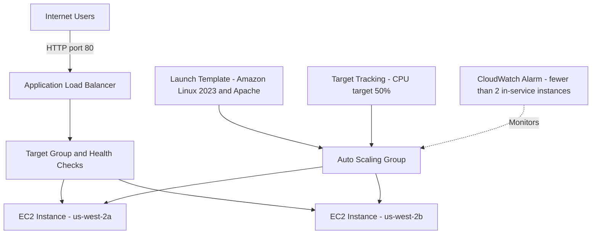

# AWS Highly Available Web Server

**Author:** Amin Shahi  
**Project:** AWS Cloud Architecture Capstone  
**AWS Region:** us-west-2 (Oregon)

## Project Overview

This project deploys a highly available web server on AWS using an Application Load Balancer (ALB), Amazon EC2, EC2 Auto Scaling, and Amazon CloudWatch. The infrastructure is defined with AWS CloudFormation.

The web application displays the project title, author, EC2 instance ID, and Availability Zone. This helps demonstrate that requests are being served by instances distributed across multiple Availability Zones.

## Architecture Diagram



## Architecture

1. A public Application Load Balancer receives HTTP requests on port 80.
2. The ALB forwards requests to a target group on port 80.
3. An EC2 Auto Scaling group maintains two instances across two Availability Zones, with a configured maximum of four.
4. The launch template uses Amazon Linux 2023 and installs Apache through EC2 user data.
5. ALB health checks monitor the web servers.
6. A target-tracking scaling policy targets 50% average CPU utilization.
7. A CloudWatch alarm monitors whether fewer than two instances are in service.

## Security

- The ALB security group permits inbound HTTP on port 80.
- The EC2 security group permits HTTP only from the ALB security group.
- The launch template requires IMDSv2 for instance metadata access.
- This demonstration uses HTTP, not HTTPS. HTTPS with an AWS Certificate Manager certificate should be considered before production use.

## Repository Contents

- `infrastructure/ha-web-server.yaml` — CloudFormation infrastructure template.
- `docs/architecture.md` — Architecture overview and diagram.
- `evidence/` — Screenshots and validation evidence.

## Deployment

Prerequisites:
- An AWS account with permissions to create the listed resources.
- AWS CLI configured for the target account.
- An existing VPC with two suitable public subnets in different Availability Zones.

Validate the template:

```bash
aws cloudformation validate-template \
  --template-body file://infrastructure/ha-web-server.yaml \
  --region us-west-2
aws cloudformation deploy \
  --template-file infrastructure/ha-web-server.yaml \
  --stack-name cs79c-ha-web-server \
  --region us-west-2

```

## Validation Results

The deployed environment was verified:

- CloudFormation stack status: `UPDATE_COMPLETE`.
- Two EC2 instances were `InService` and `Healthy`.
- Both target-group targets were `healthy`.
- The website returned HTML displaying the author name, instance ID, and Availability Zone.
- The EC2 instance refresh completed successfully.

Save screenshots in `evidence/` before deleting the stack.

## Reliability and Future Improvements

The ALB distributes requests across two Availability Zones. Auto Scaling supports instance replacement and adjusts capacity based on average CPU utilization. This project does not guarantee a specific recovery time objective (RTO) or recovery point objective (RPO), and it is not a complete regional disaster-recovery solution.

Potential improvements include HTTPS with an ACM certificate, tighter outbound security rules, monitoring notifications, tested regional recovery, and an AWS Pricing Calculator estimate.

## Cleanup

After capturing evidence and completing the report, delete the CloudFormation stack:

```bash
aws cloudformation delete-stack \
  --stack-name cs79c-ha-web-server \
  --region us-west-2

aws cloudformation wait stack-delete-complete \
  --stack-name cs79c-ha-web-server \
  --region us-west-2
```

Verify deletion in CloudFormation and confirm no project resources remain. Do not run cleanup until all required evidence has been saved.

