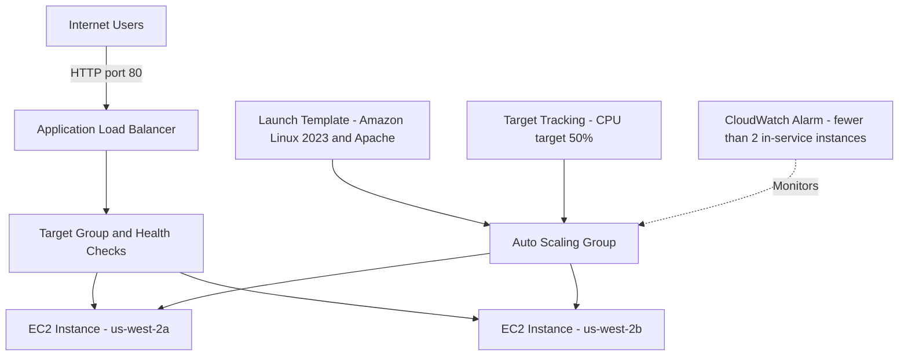

# AWS Highly Available Web Server — Architecture

**Author:** Amin Shahi  
**Region:** us-west-2 (Oregon)

## Architecture Diagram

## Component Responsibilities

- **Application Load Balancer:** Provides a public endpoint and distributes requests to healthy targets.
- **Target group:** Routes requests to EC2 web servers and performs health checks.
- **Amazon EC2:** Runs Apache and serves the web page.
- **Auto Scaling:** Maintains two instances across two Availability Zones, with a maximum capacity of four.
- **Launch template:** Defines the instance configuration and startup commands.
- **CloudWatch:** Monitors in-service instance count; target tracking adjusts capacity based on average CPU utilization.
- **CloudFormation:** Creates and manages infrastructure from `infrastructure/ha-web-server.yaml`.

## Design Decisions

The ALB distributes traffic and checks target health. Auto Scaling supports instance replacement and scaling. CloudFormation makes deployment repeatable. Two Availability Zones reduce dependence on a single zone, but this is not a complete regional disaster recovery solution.

## Security

The ALB accepts HTTP on port 80. The EC2 security group permits web traffic only from the ALB security group. The launch template requires IMDSv2. HTTPS, tighter outbound rules, and monitoring notifications are potential production improvements.

## Verification

The deployment was verified with two EC2 instances in service, two healthy target-group targets, and a successful HTTP response from the ALB. Save evidence in `evidence/` before deleting the stack.
